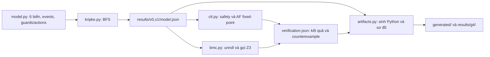

# Mô hình hóa và kiểm chứng Smart Lock bằng Kripke, CTL và BMC/Z3

Bài tập lớn môn **An toàn phần mềm** — nhóm 4 sinh viên.
**Nhóm / lớp / học kỳ:** [NHÓM ĐIỀN]. **Thành viên, họ tên và MSSV:** [NHÓM ĐIỀN].

## 1. Giới thiệu

Dự án mô phỏng khóa cửa thông minh bằng một mô hình Kripke tích hợp cho mỗi
phiên bản: **v0** chứa hai lỗi cố ý; **v1** sửa hai lỗi đó. BFS tự sinh các
trạng thái reachable; CTL và BMC/Z3 kiểm tra đúng năm đặc tả.
Bàn giao bằng **repository GitHub**, gồm source, bằng chứng và hai PDF:
[báo cáo](report/BaoCao_BTL_Kripke.pdf) và
[giải thích code, 25 câu hỏi–đáp](report/TaiLieu_HocVaGiaiThichCode.pdf).

## 2. Năm chức năng nghiệp vụ

1. **Authentication:** nhận kết quả mật khẩu đúng/sai, thiết lập xác thực.
2. **Account Lockout:** sai đúng **ba lần liên tiếp** mới khóa tài khoản.
3. **Door Control:** mở/đóng cửa; v1 yêu cầu xác thực khi mở.
4. **Alarm:** phát hiện can thiệp qua `tamper`, bật báo động và đóng cửa.
5. **Admin Recovery:** yêu cầu xác thực admin tường minh, reset về trạng thái đầu.

## 3. Công nghệ và luồng xử lý

Python; Kripke `M = (S, S0, R, L)`; BFS; CTL; bounded model checking (BMC);
Z3 SMT Solver; pytest; Graphviz DOT/SVG/PNG.



## 4. Cấu trúc và nơi đọc code

```text
smartlock/       model.py, kripke.py, ctl.py, bmc.py, artifacts.py
generated/     v0/smart_lock.py, v1/smart_lock.py
tests/         4 file kiểm thử: mô hình, BFS, kiểm chứng, mã sinh
toolkit/       softsec-toolkit/ch1_models/kripke.py (module cần thiết)
results/       v0/, v1/, comparison.csv, bằng chứng g1–g5 và github/
report/        2 PDF, nguồn Markdown và công cụ biên soạn PDF
docs/          thiết kế G1, giải thích G2–G4, phân công và checklist
run.py         CLI mô phỏng, kiểm chứng, sinh mã và sơ đồ
 requirements.txt, pytest.ini, .gitignore, .gitattributes
```

Bắt đầu từ [sáu biến và guard/action](smartlock/model.py),
[BFS và adapter Kripke](smartlock/kripke.py),
[đặc tả CTL](smartlock/ctl.py), [mã hóa Z3](smartlock/bmc.py),
[bộ sinh mã](smartlock/artifacts.py). Thiết kế và giải thích chi tiết:
[G1](docs/G1_ThietKe.md), [G2](docs/G2_GiaiThich.md),
[G3](docs/G3_GiaiThich.md), [G4](docs/G4_GiaiThich.md).

## 5. Năm đặc tả CTL

AP được tính trực tiếp từ trạng thái trong `model.py::labels`.
`AG`: tại mọi trạng thái trên mọi đường đi; `AF`: trên mọi đường đi,
cuối cùng phải đạt trạng thái thỏa điều kiện.

| Mã | Công thức | Ý nghĩa |
|---|---|---|
| P1 | `AG(door_open -> (authenticated AND NOT locked_out))` | Mở cửa phải có xác thực và chưa bị khóa tài khoản |
| P2 | `AG(locked_out -> attempts_eq_3)` | Khi khóa tài khoản, số lần sai bằng 3 |
| P3 | `AG(alarm -> NOT door_open)` | Báo động thì cửa đóng |
| P4 | `AG(resetting -> admin_authorized)` | Reset phải có quyền quản trị |
| P5 | `AG(resetting -> AF idle)` | Mọi lần reset đều phải hoàn tất trên mọi đường đi |

P1–P4: duyệt bad-state trên toàn graph và BMC/Z3.
P5: CTL least fixed-point cho `AF idle`, kèm lasso khi vi phạm.

## 6. Cài đặt

Cần Python **3.10 trở lên**, Git và Graphviz `dot` để chạy đầy đủ tests/sinh ảnh.
Môi trường kiểm tra bàn giao: Windows, Python 3.14.2, pytest 9.1.1,
z3-solver 5.1.0.0, Graphviz 16.1.0; chưa chạy kiểm thử trên Linux/macOS.

```sh
git clone https://github.com/bbaonngoc/kripke-model-checking.git
cd kripke-model-checking
python -m venv .venv
```

Trên Windows có thể dùng `py -3 -m venv .venv` nếu lệnh `python` chưa trỏ
đúng interpreter. Kích hoạt môi trường: PowerShell dùng
`.\.venv\Scripts\Activate.ps1`; Linux/macOS dùng `source .venv/bin/activate`.
Nếu PowerShell chặn script kích hoạt, gọi trực tiếp `.\.venv\Scripts\python.exe`
thay cho `python` trong các lệnh dưới đây.

```sh
python -m pip install -r requirements.txt
dot -V
```

Cài Graphviz từ [trang chính thức](https://graphviz.org/download/), thêm thư
mục chứa `dot` vào PATH rồi mở lại terminal. Có thể đặt `GRAPHVIZ_DOT`
trỏ tới file thực thi; cài package Python tên `graphviz` không thay thế `dot`.
Graphviz chỉ cần để tái sinh sơ đồ và chạy đầy đủ tests; xem ảnh/PDF có sẵn
hoặc chạy hai chương trình sinh không cần Graphviz.

## 7. Chạy mô phỏng

Chạy từ gốc repository. Đầu ra thử nghiệm đặt trong `tmp/` để giữ nguyên
bằng chứng đã bàn giao trong `results/` và `generated/`.

```sh
python -X utf8 run.py --version v1 --output-dir tmp/demo --events password_ok open_door close_door
python -X utf8 run.py --version v1 --output-dir tmp/demo --events password_bad password_bad password_bad
python -X utf8 run.py --version v1 --output-dir tmp/demo --events tamper admin_reset reset_complete --admin-authenticated
```

CLI in sáu giá trị sau mỗi bước. Cờ admin biểu diễn **kết quả xác thực
quản trị** trong mô hình, chưa phải cơ chế mật khẩu admin thực tế.

Hai chương trình sinh [v0](generated/v0/smart_lock.py) và
[v1](generated/v1/smart_lock.py) chạy độc lập bằng thư viện chuẩn:

```sh
python -I -S generated/v0/smart_lock.py --events open_door
python -I -S generated/v1/smart_lock.py --events password_ok open_door
python -I -S generated/v1/smart_lock.py --events open_door
```

Lệnh cuối **phải bị từ chối và trả exit code 1**. v0 mở được cửa ngay từ
`s0`, tái hiện lỗi cố ý. Runtime tra bảng chuyển tiếp sinh từ JSON; không
import `smartlock/model.py` và không âm thầm chọn nhánh bất định.

## 8. Chạy lại BFS, kiểm chứng và sinh mã/sơ đồ

Chạy lần lượt ba lệnh, cùng thư mục đầu ra:

```sh
python -X utf8 run.py --output-dir tmp/recheck
python -X utf8 run.py --verify --output-dir tmp/recheck
python -X utf8 run.py --artifacts --output-dir tmp/recheck --generated-dir tmp/gen
```

Mặc định xử lý cả v0/v1. Với `--verify`, có thể thêm `--version v0` hoặc
`--version v1`. Kết quả mới ở `tmp/recheck/v0, v1/verification.json`;
ảnh và CSV ở `tmp/recheck/g4/`. BMC gọi Z3 thật từ `k=0` tăng dần;
JSON lưu từng lần gọi, SMT-LIB, SAT/UNSAT/UNKNOWN và lỗi ứng dụng riêng.

**Không đổi xuống dòng của snapshot đã bàn giao.** `.gitattributes` giữ
nguyên byte vì G3/G4 đối chiếu SHA-256 với G2. Muốn tạo kết quả mới, chạy
cả chuỗi vào thư mục mới như trên, không trộn model mới với verification cũ.

## 9. Xem sơ đồ và counterexample

- Kripke tổng thể: [v0 PNG](results/g4/diagrams/kripke_v0.png), [v1 SVG](results/g4/diagrams/kripke_v1.svg).
- Chức năng: [Authentication + Lockout](results/g4/diagrams/authentication_lockout.svg), [Door + Alarm](results/g4/diagrams/door_alarm.svg), [Admin Recovery](results/g4/diagrams/admin_recovery.svg).
- **P1 v0:** [sơ đồ](results/g4/diagrams/counterexample_p1_v0.png); `s0 --open_door--> s3`, vi phạm sau 1 bước.
- **P5 v0:** [sơ đồ](results/g4/diagrams/counterexample_p5_v0.png); prefix `s0 --admin_reset--> s5` (admin=true), chu trình `s5 --reset_retry--> s5` lặp vô hạn.

Cả bảy sơ đồ có DOT, SVG và PNG trong [diagrams/](results/g4/diagrams/).
Mã state được giải thích ở [state_legend.csv](results/g4/state_legend.csv).
Mỗi trace đầy đủ có state/event/quyền admin và đã replay với mô hình G2:
[JSON v0](results/v0/verification.json), [JSON v1](results/v1/verification.json).

## 10. Chạy kiểm thử

```sh
python -X utf8 -m pytest --color=no -p no:cacheprovider -v
```

Bộ dự án có **199 tests**: 78 G2 + 72 G3 + 49 G4. Tests kiểm tra nghiệp vụ,
BFS, CTL, BMC/Z3, SAT/UNSAT/UNKNOWN/ERROR, replay, mã sinh và ảnh.
Đối chiếu mã sinh bao phủ **702 trường hợp** = mọi state × 9 events ×
2 giá trị quyền admin, gồm **115 cạnh hợp lệ** của hai mô hình.

Bằng chứng chạy từ cây source sạch lấy qua Git index, với venv mới và
Graphviz cài mới: [validation.json](results/github/validation.json),
[log lệnh và tests](results/github/validation.log).
Các log G5 ghi 203 = 199 tests dự án + 4 tests tham chiếu từ tài liệu G1;
4 tests tham chiếu không thuộc bộ `tests/` và không yêu cầu tài liệu lớp để
chạy lại 199 tests trong repository này.

## 11. Kết quả kiểm chứng thực tế

| Thuộc tính | Phương pháp | v0 | v1 | Bound liên quan |
|---|---|---|---|---|
| P1 | Duyệt graph + BMC/Z3 | VIOLATED; CE 1 bước | HOLDS | v0: 0–1; v1: 0–5 |
| P2 | Duyệt graph + BMC/Z3 | HOLDS | HOLDS | 0–5 |
| P3 | Duyệt graph + BMC/Z3 | HOLDS | HOLDS | 0–5 |
| P4 | Duyệt graph + BMC/Z3 | HOLDS | HOLDS | 0–5 |
| P5 | CTL AF fixed-point | VIOLATED; lasso | HOLDS | Không dùng safety bound |

v0: **21 states, 69 event transitions, 65 cặp R**; v1: **18, 46, 42**.
Độ sâu ngắn nhất lớn nhất **D=5** cho cả hai. Một lần kiểm chứng đầy đủ
có **44 lần gọi Z3: 1 SAT, 43 UNSAT, 0 UNKNOWN, 0 ERROR**.
UNSAT ở bound nhỏ chỉ có nghĩa chưa có phản ví dụ tới bound đó; D đủ cho
bốn thuộc tính safety dạng bad-state reachable hiện tại, không áp dụng cho P5.

Bằng chứng: [model v0](results/v0/model.json), [model v1](results/v1/model.json),
[bảng so sánh G3](results/comparison.csv),
[tổng hợp G4 CSV](results/g4/experiment_summary.csv),
[audit mã sinh](results/g4/experiment_summary.json),
[đối chiếu G5](results/g5/evidence_audit.json).

## 12. Giới hạn và giả định

Chỉ các trạng thái reachable của sáu biến đã thiết kế; action nguyên tử;
mật khẩu/admin là input đúng/sai trừu tượng. v1 chỉ cho `reset_complete`
ra khỏi resetting, không có bước chờ vô hạn tại đó. Không giả định fairness
để che chu trình lỗi của v0. P2 một chiều cần test riêng lần sai thứ ba.
Kết quả chứng minh năm đặc tả trên mô hình hữu hạn, chưa chứng minh an toàn
phần cứng, mật khẩu thật, mạng hoặc mọi chi tiết triển khai khóa vật lý.

## 13. Báo cáo và bàn giao

Hai PDF đã có sẵn trong [report/](report/); nguồn Markdown và
[build_pdfs.py](report/build_pdfs.py) được giữ để nhóm điền bìa, biên soạn lại.
Biên soạn PDF cần thêm [requirements-report.txt](report/requirements-report.txt)
và các font Times New Roman, Consolas, Arial, Cambria của môi trường biên soạn;
không cần các font/package này để mô phỏng, kiểm chứng hoặc chạy pytest.
Nhóm hoàn thiện placeholder theo [phân công](docs/PhanCongNhom.md) và
[checklist](docs/Checklist_NopBai.md). Danh sách file bàn giao:
[files_to_commit.txt](results/github/files_to_commit.txt).

## 14. Tài liệu tham khảo và AI hỗ trợ

- Tài liệu môn An toàn phần mềm và softsec-toolkit được cung cấp trong lớp;
  ghi nguồn trong báo cáo. [Thông báo mã bên thứ ba](THIRD_PARTY_NOTICES.md):
  quyền công khai module toolkit đang chờ nhóm xác nhận; không tự gán giấy phép.
- [Z3 — source và hướng dẫn chính thức](https://github.com/Z3Prover/z3);
  [Graphviz — DOT](https://graphviz.org/doc/info/lang.html).
- Đặc tả CTL, định nghĩa fixed-point và giới hạn kết luận được trình bày trong
  [G3_GiaiThich.md](docs/G3_GiaiThich.md) và tài liệu tham khảo của báo cáo.
- AI hỗ trợ đáng kể trong thiết kế, viết code/tests, diễn giải và biên soạn
  tài liệu. Nhóm chịu trách nhiệm đọc hiểu, chạy lại, đối chiếu bằng chứng và
  xác nhận đóng góp thực tế trước khi nộp.
